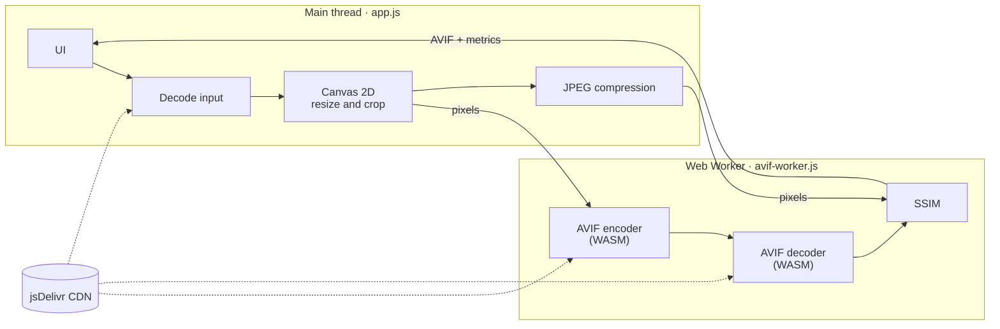
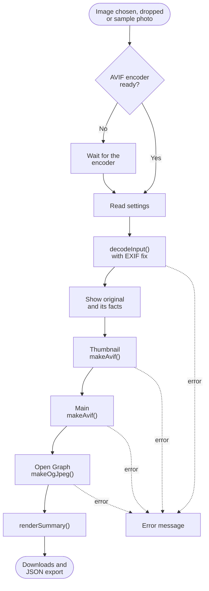
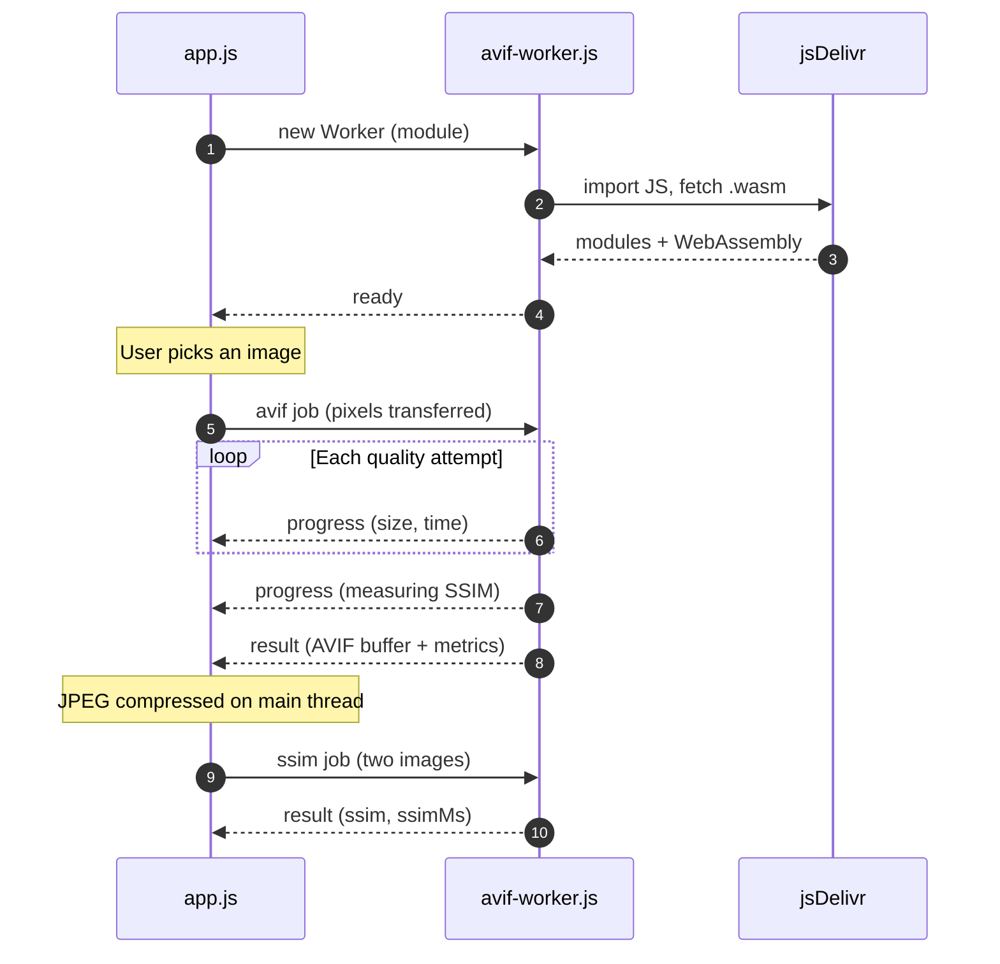
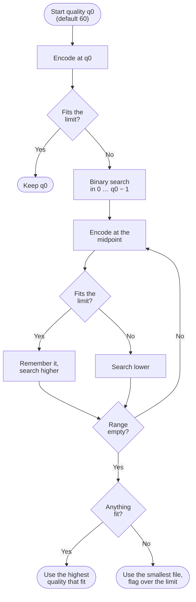
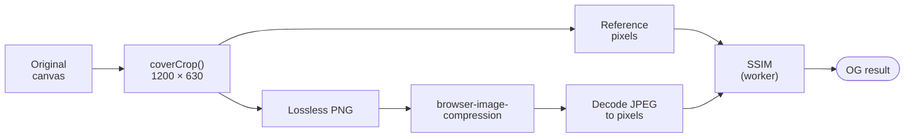

# KARPI · In-browser image compression PoC (AVIF + JPEG)

A proof of concept that takes **a single image** and, entirely in the browser (no processing server), produces three web-ready versions, each kept under a configurable size limit:

| Output | Format | Dimensions | Rule |
|---|---|---|---|
| **Thumbnail** | AVIF | 800 px wide, height auto | Keeps proportions, never upscales |
| **Main** | AVIF | Fits inside 1920 × 2800 px | Keeps proportions, never upscales |
| **Open Graph** | JPEG | Exactly 1200 × 630 px | Centre crop, white behind transparency |

When it finishes, the page shows a comparison table with **final size, compression ratio, SSIM (perceived quality) and timings**, and lets you download each file or copy the results as JSON.

---

## Contents

- [Running it](#running-it)
- [Project structure](#project-structure)
- [Architecture](#architecture)
- [End-to-end flow](#end-to-end-flow)
- [Talking to the worker](#talking-to-the-worker)
- [AVIF quality search under the limit](#avif-quality-search-under-the-limit)
- [JPEG pipeline (Open Graph)](#jpeg-pipeline-open-graph)
- [Resizing and cropping](#resizing-and-cropping)
- [Metrics](#metrics)
- [Settings](#settings)
- [Compatibility and limitations](#compatibility-and-limitations)

---

## Running it

The page uses a **module Web Worker** and loads WebAssembly, so it **must be served over `http://`**. Opening `index.html` by double-clicking it (`file://`) does not work.

```bash
python -m http.server 8765
```

Then open <http://localhost:8765/> and either:

1. Click **"Try with the sample photo"** to test with the bundled image (`assets/sample.jpg`), **or**
2. Drop or choose your own image.

Any static server works (`npx serve`, VS Code's Live Server extension, etc.). There is no build step and nothing to install: the libraries load from jsDelivr.

> ⚠️ Don't serve the page with `COOP`/`COEP` headers (cross-origin isolation). With them, jSquash tries to use its multi-threaded build, which needs files the CDN doesn't expose. The worker detects this and shows an explanatory error.

---

## Project structure

```
.
├── index.html            # Markup only: header, controls, result sections
├── css/
│   └── styles.css        # Styles (colour tokens, dark mode, responsive layout)
├── js/
│   ├── app.js            # Main thread: UI, decoding, resizing, JPEG, orchestration
│   └── avif-worker.js    # Web Worker: AVIF encode/decode and SSIM
└── assets/
    └── sample.jpg        # Test photo (2000 × 1281 px, ~443 KB)
```

### External libraries

| Library | Version | Used in | Purpose |
|---|---|---|---|
| [`browser-image-compression`](https://github.com/Donaldcwl/browser-image-compression) | 2.0.2 | `app.js` (main thread) | Decode the input (with EXIF orientation) and compress the Open Graph JPEG under the limit |
| [`@jsquash/avif`](https://github.com/jamsinclair/jSquash) | 2.1.1 | `avif-worker.js` | Encode and decode AVIF with libavif compiled to WebAssembly |

---

## Architecture

Work is split across two threads so the UI **never freezes**: the main thread owns the UI and the canvas (which only exists there), and the worker does the CPU-heavy work (AVIF and SSIM).



| Box | Library / API |
|---|---|
| Decode input, JPEG compression | `browser-image-compression` |
| AVIF encoder / decoder | `@jsquash/avif` (libavif in WebAssembly) |
| Canvas 2D | Native `<canvas>`, `getImageData`, `toBlob` |
| SSIM | Hand-written in `avif-worker.js` |

Key design points:

- **Pixel buffers are transferred, not copied.** `postMessage(..., [buffer])` hands the `ArrayBuffer` to the worker at no copy cost, which matters for bitmaps that are several MB.
- **The `.wasm` files are compiled explicitly** in the worker (`WebAssembly.compileStreaming`, falling back to `compile(arrayBuffer)` if the server sends the wrong MIME type) and passed to `init()`. That way the codec never has to guess where its `.wasm` lives when loaded from a CDN.
- **The worker starts as soon as the page loads**, while the user is still picking an image. If the user is faster than the load, `run()` waits on `codecReadyPromise`.
- **The three outputs are produced one after another**, not in parallel, so the timings measured for each one don't overlap.

---

## End-to-end flow



| Step | Size function | Target |
|---|---|---|
| Thumbnail | `fitWidth(src, 800)` | 800 px wide |
| Main | `fitInside(src, 1920, 2800)` | Inside 1920 × 2800 |
| Open Graph | `coverCrop(src, 1200, 630)` | Exactly 1200 × 630 |

Each output card moves through `waiting → running → done` (or `error`), and its log shows every encoder attempt live. A typical error is an HEIC file opened outside Safari.

---

## Talking to the worker

`app.js` wraps the worker in a small promise layer (`runInWorker`): each job gets an `id`, is stored in a `Map` of pending jobs, and incoming messages (`progress`, `result`, `error`) are routed to the right job.



| Message | Direction | Payload |
|---|---|---|
| `ready` | worker → app | Codec load time in ms |
| `init-error` | worker → app | Codec failed to load (network, COOP/COEP…) |
| `avif` | app → worker | `{ image, maxBytes, startQuality, speed }` |
| `ssim` | app → worker | `{ a, b }`, two RGBA images of the same size |
| `progress` | worker → app | A text line for the card's log |
| `result` | worker → app | AVIF: `{ buffer, quality, fits, attempts, encodeMs, decodeMs, ssim, ssimMs }`; SSIM: `{ ssim, ssimMs }` |
| `error` | worker → app | Error message for job `id` |

---

## AVIF quality search under the limit

`encodeUnderLimit()` looks for **the highest quality that fits the limit**, without spending extra bytes:



- If the start quality already fits, it is kept: there's no point raising quality and spending more bytes.
- At most **1 + ⌈log₂ q0⌉ encodes** (≈ 7 with q0 = 60).
- Every attempt is recorded (`quality`, `bytes`, `ms`, `fits`) and added to the **compression time**.
- The chosen AVIF is then **decoded again** and its SSIM measured against the resized pixels before compression.

---

## JPEG pipeline (Open Graph)



The library call:

```js
imageCompression(pngFile, {
  fileType: 'image/jpeg',
  maxSizeMB: settings.maxBytes / (1024 * 1024),
  initialQuality: settings.jpegQuality / 100,
  alwaysKeepResolution: true,
  maxIteration: 30,
  useWebWorker: false,
});
```

- The crop is handed to the library as a **PNG** so no loss is introduced before the real compression.
- `alwaysKeepResolution: true` stops the library from shrinking the image below 1200 × 630 when it struggles to hit the limit: it only lowers quality.
- `useWebWorker: false` because the heavy lifting already runs in our own worker, which avoids loading a second worker for the library.

---

## Resizing and cropping

Everything uses the **native 2D canvas** (`imageSmoothingQuality = 'high'`):

- **`resizeCanvas(src, w, h)`** – for big reductions it **halves in successive steps** and does one final draw at the exact size. This avoids the aliasing you get when shrinking an image a lot in a single draw.
- **`fitWidth(src, 800)`** – scales by `min(1, 800 / width)`: never upscales.
- **`fitInside(src, 1920, 2800)`** – scales by `min(1, 1920 / width, 2800 / height)`: never upscales.
- **`coverCrop(src, 1200, 630)`** – scales to *cover* the box and crops the centre. This is the only output that **does upscale** when the original is smaller, because Open Graph needs the exact size. It fills white first because JPEG has no transparency.

The input is decoded with `imageCompression.drawFileInCanvas()`. If the browser doesn't apply EXIF orientation itself (`isAutoOrientationInBrowser()` returns false), it is corrected with `getExifOrientation()` + `followExifOrientation()`.

---

## Metrics

| Metric | How it's computed | What it tells you |
|---|---|---|
| **Final file size** | Bytes of the output file | Real weight (1 KB = 1024 bytes) |
| **Ratio vs original file** | `uploaded file bytes / output bytes` | Total saving: resizing + compression combined |
| **Ratio vs raw bitmap** | `width × height × 4 / output bytes` | Codec efficiency on its own |
| **SSIM** | See below | Perceived quality vs the uncompressed image |
| **Compression time** | Encoder only (every AVIF attempt, or the whole library call for JPEG) | Cost of the codec |
| **Total time** | From resizing to that output's SSIM | Real cost of producing that version |

In the totals row, the time is the **wall-clock of the whole run** (including decoding the original).

### SSIM

Hand-written in the worker (`ssim()`), following Wang et al. (2004):

1. Both images are converted to **BT.601 luma** (`0.299 R + 0.587 G + 0.114 B`), **compositing transparency over white**.
2. The image is scanned in **8 × 8 px windows with a 4 px stride**.
3. SSIM is computed per window with `K1 = 0.01`, `K2 = 0.03`, `L = 255`, then averaged.

Rough guide:

| SSIM | Reading |
|---|---|
| ≥ 0.98 | Visually identical |
| 0.95 – 0.98 | Excellent |
| 0.90 – 0.95 | Good |
| < 0.90 | Visible loss |

### Results with the sample photo

Default settings (600 KB limit, AVIF q60 / speed 6, JPEG q85), Chromium on Windows:

| Output | Dimensions | Size | SSIM | Compression | Total |
|---|---|---|---|---|---|
| Thumbnail AVIF | 800 × 512 | 50.2 KB | 0.9778 | 842 ms | 1.02 s |
| Main AVIF | 1920 × 1230 | 211.7 KB | 0.9813 | 5.18 s | 5.59 s |
| Open Graph JPEG | 1200 × 630 | 177.2 KB | 0.9806 | 49 ms | 824 ms |

Timings depend heavily on the machine; treat the table as an order of magnitude.

---

## Settings

| Field | Range | Default | Effect |
|---|---|---|---|
| Size limit per file | 10 – 10,000 KB | 600 | Maximum size of each output |
| AVIF starting quality | 1 – 100 | 60 | Quality of the first attempt; only lowered if it doesn't fit |
| AVIF encoder speed | 0 – 10 | 6 | 0 = slowest and smallest, 10 = fastest |
| JPEG starting quality | 1 – 100 | 85 | Starting quality that `browser-image-compression` lowers if needed |

Out-of-range values are clamped to the nearest limit. **"Run again with these settings"** reprocesses the same image with the new settings.

---

## Compatibility and limitations

- **Input formats:** JPEG, PNG, WebP, GIF, BMP and AVIF work in every modern browser. **HEIC and TIFF only open in Safari**, and RAW formats in none; in those cases the page asks you to convert the file.
- **Needs network access** the first time, to download the libraries and `.wasm` files from jsDelivr.
- **Single-threaded AVIF encoding:** the *Main* output is the slowest (several seconds for large images). Lowering *speed* gives smaller files at the cost of more time.
- **Memory:** the decoded bitmap takes `width × height × 4` bytes; very large images (e.g. 50 MP ≈ 200 MB) can run out of memory on phones.
- If even quality 0 can't get under the limit, the smallest file found is delivered and flagged **"over the limit"**.
